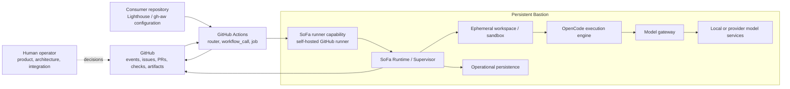

# 3. System scope and context

## Business context

SoFa is the runtime side of a personal Software Factory. GitHub remains the external backlog, source, pull-request, check, and delivery-evidence authority. Lighthouse runs the repository lifecycle in the consumer repository. SoFa supplies bounded execution capacity and operational recovery on Bastion.

The initial boundary has no central SoFa webhook. GitHub delivers an event to the Lighthouse router; the router validates the route and prerequisites; a Lighthouse worker runs in a GitHub Actions job; the job is placed on the SoFa-supplied runner capability. SoFa receives the job's explicit execution contract and supervises the isolated execution. A later ingress can be introduced only as an additional transport adapter, not as a new lifecycle authority.

## Technical context

| External system or boundary | Interface in the initial architecture | SoFa interpretation |
| --- | --- | --- |
| Consumer repository | Lighthouse configuration, generated gh-aw workflows, repository checkout, artifacts. | Source of the execution request and stage-result location; not SoFa-owned lifecycle state. |
| GitHub Actions | Event trigger, router job, `workflow_call`, runner labels, job status, artifacts. | Initial dispatch and execution transport. |
| GitHub API | Issues, PRs, checks, commits, workflow runs, review and merge evidence. | External source/evidence authority; SoFa stores references and observations. |
| Lighthouse router/workers | Route/stage input, prerequisites, stage prompts, stage-result contract. | Lifecycle authority to be invoked, never reimplemented by SoFa. |
| SoFa runner capability | Local bridge from the GitHub job to the SoFa runtime. | Admission, supervision, and result handoff; component deployed with SoFa. |
| OpenCode | Scoped execution request and bounded process/tool results. | External engine supervised by SoFa; not a lifecycle or persistence authority. |
| Model gateway | Engine model requests, routing, masking, token metadata, health. | Existing or future Bastion service boundary; SoFa observes and correlates it. |
| Local/provider model services | Model inference. | Provider/runtime dependency; no product or merge authority. |

### Scope boundaries

In scope are runtime coordination, scheduling, admission, leases, fencing, checkpoints, recovery, capacity, worker supervision, workspace lifecycle, isolation, operational persistence, health, and Bastion operation.

Out of scope are Lighthouse stage semantics, route policy, gate decisions, agent prompts, repository lifecycle definitions, model serving, provider policy, and human acceptance. SoFa may record references to these things, but it does not become their source of truth.
