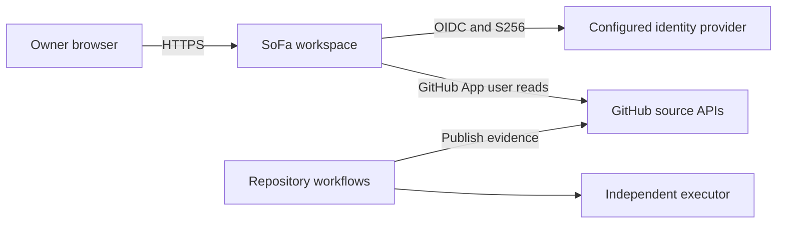

# 03. System context

The owner uses an authenticated SoFa browser workspace or GitHub directly. GitHub owns issue, conversation, run, PR and artifact records. Lighthouse owns shared lifecycle and evidence semantics; repository workflows and the independent executor own delivery.

<!-- pdac:cite id="BR-GITHUB-SOURCE" digest="sha256:fd8141424d5fead38ed55d54689511fc445467133706e875371cc3199af8ab1a" -->

## Interfaces and responsibility

| Participant | Current interface | Boundary or remaining target |
| --- | --- | --- |
| Owner | HTTPS browser, owner session and explicit source linking | Routine issue commands remain future work |
| Identity provider | OIDC code/S256, assurance and online session revalidation | The development provider is isolated; external production operation is not proven |
| GitHub | App user authorization and user-attributed reads | Repository permission and app grant are checked separately from sign-in |
| Lighthouse | Installed repository lifecycle and evidence contract | Shared command eligibility, correlation and continuation integration remain future work |
| Runtime and infrastructure | Repository-operated execution and published evidence | No dependency on the workspace or its development provider |

<!-- pdac:cite id="BR-LAN-PRIVILEGE-BOUNDARY" digest="sha256:318c7d8d4d3b2e27109e24628f99dd1825494fa9858dc13410032d73650f1cc8" -->

The implemented blocks are in [section 05](../05-building-block-view/README.md); environment mapping is in [section 07](../07-deployment-view/README.md). Actual GitHub consent and physical-device acceptance are evidence gaps, not inferred from test fixtures.
