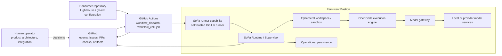

# 3. System scope and context

## Business context

SoFa is the runtime side of a personal Software Factory. GitHub remains the external backlog, source, pull-request, check, and delivery-evidence authority. Lighthouse runs the repository lifecycle in the consumer repository. SoFa supplies bounded execution capacity and operational recovery on Bastion.

The current Lighthouse SDLC router is triggered by `workflow_dispatch`. Its stage workers are invoked through `workflow_call`; the repository guardrail workflow has separate `pull_request`, `push`, and `workflow_dispatch` triggers and is not an SDLC execution trigger. There is no current issue or pull-request event that invokes the SDLC router, and there is no central SoFa webhook.

The current workflow projection places the agent job on `[self-hosted, linux, lighthouse-sdlc]`. That label is a GitHub Actions scheduling capability, not a callback into a SoFa process. The published workflow executes the gh-aw agent in that job and produces the Lighthouse `stage-result`; no SoFa handoff or supervisor process is currently implemented. The target architecture therefore requires an explicit host adapter before SoFa can receive an execution contract or supervise a separate execution worker. A later ingress can be introduced only as an additional transport adapter, not as a new lifecycle authority.

## Technical context

| External system or boundary | Interface in the initial architecture | SoFa interpretation |
| --- | --- | --- |
| Consumer repository | Lighthouse configuration, generated gh-aw workflows, repository checkout, artifacts. | Source of the execution request and stage-result location; not SoFa-owned lifecycle state. |
| GitHub Actions | Event trigger, router job, `workflow_call`, runner labels, job status, artifacts. | Initial dispatch and execution transport. |
| GitHub API | Issues, PRs, checks, commits, workflow runs, review and merge evidence. | External source/evidence authority; SoFa stores references and observations. |
| Lighthouse router/workers | Route/stage input, prerequisites, stage prompts, stage-result contract. | Lifecycle authority to be invoked, never reimplemented by SoFa. |
| SoFa runner capability | Current GitHub Actions capability label supplied by the Bastion runner; future local bridge from a job to the SoFa runtime. | The label alone does not create admission, supervision, or a result handoff. |
| OpenCode | Scoped execution request and bounded process/tool results. | External engine supervised by SoFa; not a lifecycle or persistence authority. |
| Model gateway | Engine model requests, routing, masking, token metadata, health. | Existing or future Bastion service boundary; SoFa observes and correlates it. |
| Local/provider model services | Model inference. | Provider/runtime dependency; no product or merge authority. |

### Current versus target execution boundary

The current Lighthouse package is the observed execution authority at the GitHub Actions job boundary: the worker workflow selects the gh-aw `copilot` engine, runs on the self-hosted capability, and validates/uploads the `stage-result`. The SoFa runtime, SoFa runner adapter, OpenCode process boundary, and Bastion model gateway remain target components with no implementation evidence in this repository.

The target may add a SoFa-owned handoff inside the job or replace the job's engine through a Lighthouse-supported host contract. That choice is open until the Lighthouse engine contract and the SoFa-to-runner transport are specified and verified.

### Scope boundaries

In scope are runtime coordination, scheduling, admission, leases, fencing, checkpoints, recovery, capacity, worker supervision, workspace lifecycle, isolation, operational persistence, health, and Bastion operation.

Out of scope are Lighthouse stage semantics, route policy, gate decisions, agent prompts, repository lifecycle definitions, model serving, provider policy, and human acceptance. SoFa may record references to these things, but it does not become their source of truth.
