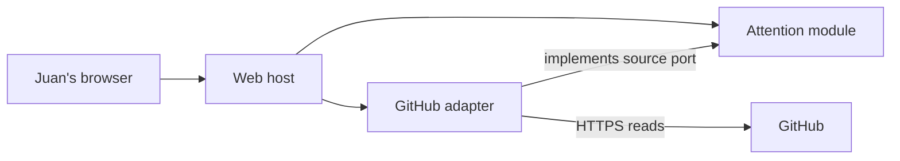

# 5. Building block view

**Approved design; implementation pending.** Juan accepted this architecture on 2026-10-19. Product intent is recorded in [CHG-INITIAL](../product/changes/completed/chg-initial/change.md).

## Level 1: system

One SoFa application process contains the following blocks. Aspire AppHost is composition infrastructure, not a business module. The paths below are proposed locations, not existing projects.

| Building block | Responsibility | Interface | Proposed source |
| --- | --- | --- | --- |
| Web host | Render the attention page, accept local refresh requests, compose dependencies | Browser; Attention use cases | `src/SoFa.Web/` |
| Attention module | Classify normalized evidence; coordinate refreshes; own snapshot and coverage semantics | Refresh and read-current operations; evidence-source port | `src/SoFa.Attention/` |
| GitHub adapter | Read, paginate, and normalize GitHub evidence | Implements Attention’s evidence-source port | `src/SoFa.GitHub/` |
| AppHost | Launch the application and connect operational telemetry | Aspire resource configuration | `src/SoFa.AppHost/` |

The diagram shows dependencies; the host references the adapter to compose it. At runtime Attention calls the source port implemented by the adapter. Attention references neither ASP.NET Core nor GitHub transport types. The adapter does not choose business classifications, and the host does not reimplement them.

## Level 2: Attention

Use domain and application namespaces within one assembly initially. Pure classification consumes normalized observations and returns findings governed by [the evidence rule](../product/model/business-rules/br-evidenced-attention.md). Application orchestration gathers observations through the port and produces an immutable snapshot with per-category outcomes. HTTP objects and credentials cannot cross that port.

<!-- pdac:cite id="BR-EVIDENCED-ATTENTION" digest="sha256:b1faa84dc95658ee7d2fd1cb6ea258028a75e61cd71ccddb54cbd133bd1edf37" -->

Keep only the latest snapshot in process. No persistence abstraction, generic repository layer, shared kernel, plugin registry, or mediator is needed for this slice. A future UI can call the same use cases. Future execution capabilities need their own approved boundaries; they cannot gain authority by extending the read adapter.
