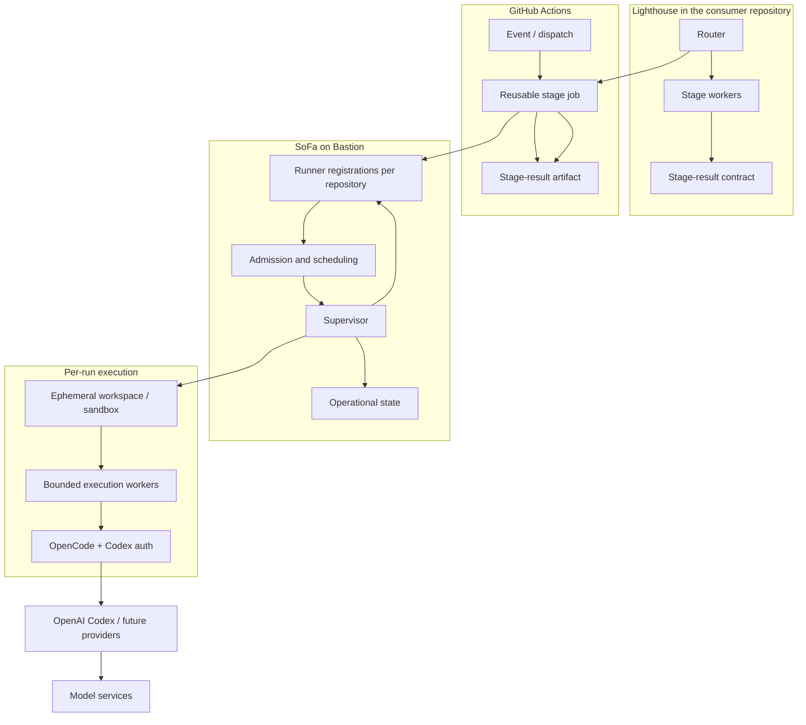

# 5. Building block view

## Level 1: system

SoFa is one runtime boundary inside a larger delivery system. The following ownership map is authoritative for this architecture:

| Building block | Owner | Responsibility | Explicitly does not own |
| --- | --- | --- | --- |
| Lighthouse router | Lighthouse | Validate event inputs, route, prerequisites, and composition mode. | SoFa leases, workspace lifecycle, or model execution. |
| Lighthouse stage worker | Lighthouse | Execute exactly one configured stage and produce the current `stage-result` contract. | Later stages, merge authorization, or runtime recovery. |
| GitHub Actions job | GitHub / consumer repository | Carry event and workflow inputs, select runner capability, upload artifacts, and report job status. | Product approval or durable SoFa operational state. |
| SoFa scheduler and admission | SoFa | Select eligible work, enforce capacity/policy, and admit explicit execution requests up to healthy capacity. | Lighthouse route or gate semantics. |
| SoFa supervisor and Worker | SoFa | Acquire leases, create checkpoints, supervise one worker per run, cancel, timeout, recover, and publish only while fenced. | Lifecycle stage meaning or human decisions. |
| SoFa runner registration set | SoFa, deployed on Bastion | Provide one repository-scoped GitHub runner registration per participating personal repository; the opt-in bridge hands an accepted job contract to the shared supervisor. | The registrations are not an account-wide GitHub runner, do not create multiple SoFa workers, and do not own lifecycle semantics. |
| Execution workspace / sandbox | SoFa runtime | Isolate checkout, tool state, and temporary artifacts for one run; clean or quarantine it at termination. | Persistent source of truth. |
| OpenCode adapter and process | SoFa integration plus OpenCode (target) | Start and supervise the persistent Bastion OpenCode process with scoped inputs, Codex/ChatGPT account authentication, cancellation, and bounded operational observation. | It is not invoked by the current Lighthouse gh-aw/Copilot projection; it does not own model serving, route selection, gates, or merge decisions. |
| Operational store | SoFa | Persist coordination, recovery, lease, checkpoint, health, and evidence references. | Credentials, raw source archives, full prompts, or full transcripts by default. |
| Model gateway | Bastion infrastructure | Route model calls, mask sensitive data, meter tokens, enforce security, and expose model health. | Agent lifecycle or GitHub delivery authority. |
| Model services | Bastion/provider | Perform inference. | SoFa or Lighthouse state. |

### Observed Lighthouse worker boundary

The current generated Lighthouse worker is not a thin callback to SoFa. Its source declares `engine: copilot` and `runs-on: [self-hosted, linux, lighthouse-sdlc]`; the compiled workflow installs and invokes the Copilot CLI in the agent job, then validates and uploads the Lighthouse `stage-result`. The separate opt-in host adapter uses `src/bridge/sofa.mjs` and the .NET supervisor in `src/SoFa.Runtime`; it does not intercept gh-aw jobs. The target decomposition therefore distinguishes this transitional GitHub Actions projection from the first SoFa execution worker, which invokes isolated OpenCode sessions on Bastion.

## Level 2: building blocks

### Supervised execution bridge and publication boundary

The versioned stage request and stage-result semantics belong to the [Lighthouse execution contract](https://github.com/juangcarmona/lighthouse/blob/main/docs/architecture/06-runtime-view/README.md#request-and-result-boundary). SoFa consumes that contract; it does not maintain a second field list or lifecycle validator.

[ADR-0004](../09-architecture-decisions/0004-local-admission-and-fenced-publication.md) defines a local bridge, an admission/supervisor process, an isolated worker and a trusted publication component. They are modules/process boundaries within the existing modular application, not separately deployed microservices. The local bridge owns IPC framing and connection failure; Lighthouse owns stage payload meaning; SoFa owns admission and operational outcomes.

The supervisor returns admission status, attempt identity, operational status, checkpoint/workspace references, bounded failure/cancellation/recovery reasons and stage/effect evidence references. A valid engine result remains a candidate until Lighthouse validation and trusted publication finish. Keep the provider credential with the engine service boundary and the GitHub mutation credential with publication. Neither is supplied by repository input or persisted in the operational store.

<!-- pdac:cite id="FR-RECOVERABLE-EXECUTION" digest="sha256:d5bed96280fd88240c3492cc4ff6a609ad80e6d6b2891e536c36f36a78772678" -->

The first implementation admits only supervised triage/refine. `SoFa.AppHost` composes PostgreSQL and the supervisor. A kernel-authenticated Unix socket binds the bridge to one repository policy; the store serializes admission with global capacity one. The supervisor runs OpenCode in a separate container and invokes the installed Lighthouse validators before its trusted GitHub publisher records an issue comment. The engine has no GitHub credential or host Docker socket. Later lifecycle stages remain roadmap work.
