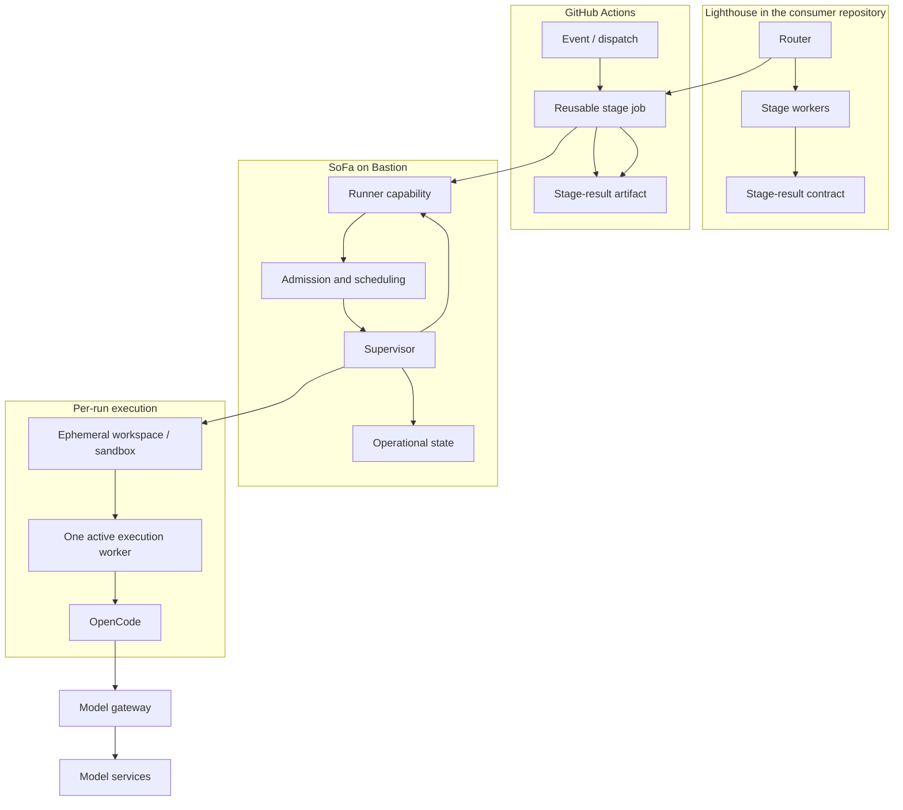

# 5. Building block view

## Level 1: system

SoFa is one runtime boundary inside a larger delivery system. The following ownership map is authoritative for this architecture:

| Building block | Owner | Responsibility | Explicitly does not own |
| --- | --- | --- | --- |
| Lighthouse router | Lighthouse | Validate event inputs, route, prerequisites, and composition mode. | SoFa leases, workspace lifecycle, or model execution. |
| Lighthouse stage worker | Lighthouse | Execute exactly one configured stage and produce the current `stage-result` contract. | Later stages, merge authorization, or runtime recovery. |
| GitHub Actions job | GitHub / consumer repository | Carry event and workflow inputs, select runner capability, upload artifacts, and report job status. | Product approval or durable SoFa operational state. |
| SoFa scheduler and admission | SoFa | Select eligible work, enforce capacity/policy, and accept one explicit execution request. | Lighthouse route or gate semantics. |
| SoFa supervisor and Worker | SoFa | Acquire leases, create checkpoints, supervise one execution worker, cancel, timeout, recover, and publish only while fenced. | Lifecycle stage meaning or human decisions. |
| SoFa runner capability | SoFa, deployed on Bastion | Provide the self-hosted runner and local handoff from a GitHub job to the supervisor. | A second repository workflow or lifecycle engine. |
| Execution workspace / sandbox | SoFa runtime | Isolate checkout, tool state, and temporary artifacts for one run; clean or quarantine it at termination. | Persistent source of truth. |
| OpenCode adapter and process | SoFa integration plus OpenCode | Start and supervise the external engine with scoped inputs and cancellation. | Model serving, route selection, gates, or merge decisions. |
| Operational store | SoFa | Persist coordination, recovery, lease, checkpoint, health, and evidence references. | Credentials, raw source archives, full prompts, or full transcripts by default. |
| Model gateway | Bastion infrastructure | Route model calls, mask sensitive data, meter tokens, enforce security, and expose model health. | Agent lifecycle or GitHub delivery authority. |
| Model services | Bastion/provider | Perform inference. | SoFa or Lighthouse state. |

## Level 2: building blocks

### Minimum Lighthouse-to-SoFa contract

The contract is logical and transport-neutral at this phase. The initial transport is a GitHub Actions job assigned to the SoFa runner capability; it is not a central webhook. The exact wire schema belongs to the implementation phase and must be versioned without redefining Lighthouse's `stage-result` schema.

The request from the Lighthouse job to SoFa must identify:

| Field | Meaning | Authority |
| --- | --- | --- |
| `contractVersion` | Version of the Lighthouse-to-SoFa handoff contract. | Joint interface, versioned explicitly. |
| `executionRunId` | Stable identifier for this attempt and its evidence. | Lighthouse supplies or correlates it; SoFa persists it. |
| `projectRef` and `repositoryRef` | Consumer project and repository identity. | GitHub / Lighthouse identity. |
| `workItemRef` | Issue or work-item identity being executed. | GitHub / Lighthouse identity. |
| `route` | Selected Lighthouse route, such as `supervised` or `plan-only`. | Lighthouse. |
| `stage` | One of the six current Lighthouse stages. | Lighthouse. |
| `sourceRevision` | Commit or checkout identity from which the job starts. | GitHub / job. |
| `prerequisiteRefs` | Prior stage-result or gate evidence needed by the route. | Lighthouse. |
| `capability` | Required runner capability, initially `[self-hosted, linux, lighthouse-sdlc]`. | Lighthouse / GitHub Actions. |
| `deadline` and `cancellation` | Bounded execution and cancellation intent. | Joint contract; SoFa enforces the operational bound. |
| `workspacePolicy` | Trusted-repository classification and allowed isolation profile. | SoFa policy, constrained by the request. |

SoFa returns an operational result containing `executionRunId`, admission status, run status, lease and checkpoint references, `workspaceRef`, `commitRef` when observed, cancellation or timeout outcome, recovery result, bounded failure reason, and references to Lighthouse stage result and delivery evidence. It does not return a replacement stage result. The exact Lighthouse `stage-result` is produced and validated by Lighthouse and remains its authority.

Minimum admission outcomes are `accepted`, `rejected`, `blocked`, or `cancelled`. A successful SoFa handoff means that execution was admitted or completed operationally; it never means that a Lighthouse gate, PR approval, merge, release, or production decision was accepted.
