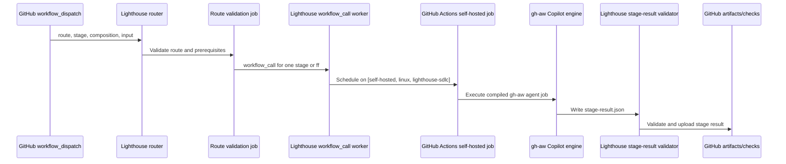
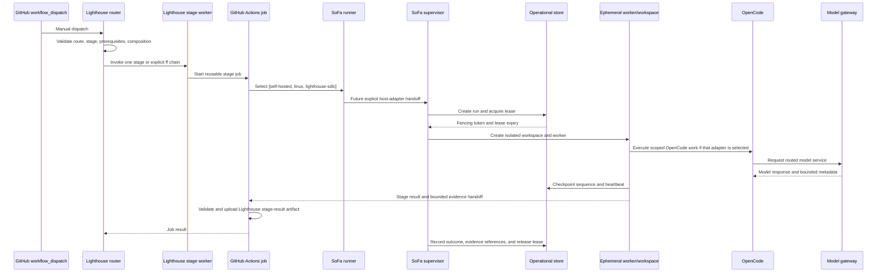
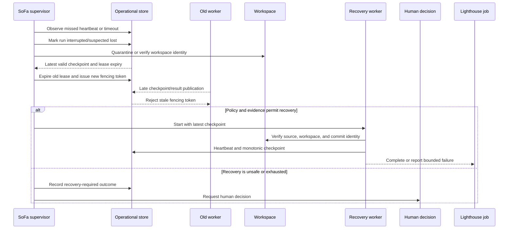

# 6. Runtime view

## Runtime scenarios

### Current Lighthouse execution boundary

This is the current observed path. The self-hosted runner executes the Lighthouse job; no SoFa process, OpenCode adapter, lease, checkpoint, or SoFa operational result is present in the path. The `lighthouse.yml` repository guardrail workflow is a separate verification workflow and is not the SDLC router.

### Target supervised execution after an explicit SoFa adapter exists

The router remains responsible for choosing a route and stage. The Lighthouse worker remains responsible for stage semantics and writing the current `stage-result` artifact. GitHub Actions remains responsible for job orchestration and artifact publication. The GitHub runner executes the job assigned to its capability. Only after an explicit adapter exists can SoFa admit and supervise a separate execution boundary, create the ephemeral workspace, record operational state, and enforce cancellation, timeout, fencing, and recovery. OpenCode performs agentic work behind the gateway only on the accepted engine path; it does not choose the lifecycle transition.

`ff` is a Lighthouse composition mode. Its next stage is invoked only after the previous job succeeds and its declared result is valid. A failed, blocked, unavailable, or missing prerequisite stops the chain. SoFa reports the operational outcome; it does not turn a successful job into an implicit human decision.

### Failure, lease expiry, and recovery

Recovery never treats a missing heartbeat as success. It is permitted only when the latest checkpoint, workspace identity, source revision, and policy make continuation safe. A stale worker cannot publish because every state-changing publication is checked against the current fencing token. If recovery bounds are exhausted or evidence is uncertain, the run stops for a human decision.

### Cancellation and timeout

Cancellation is an explicit operational outcome. The supervisor stops admitting new work for the run, requests engine cancellation, records the last acknowledged checkpoint, releases or expires the lease, and cleans or quarantines the workspace. A timeout follows the same path but records the configured timeout reason. Neither outcome is converted into a Lighthouse gate or delivery acceptance.
