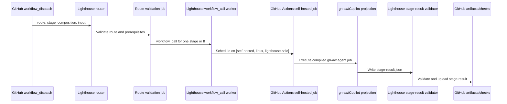
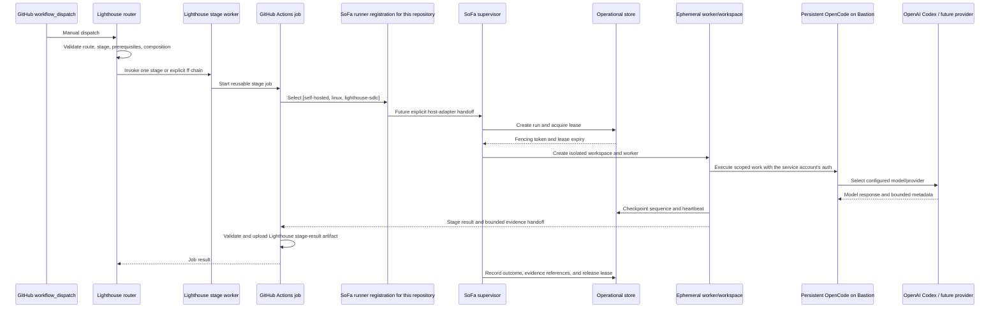
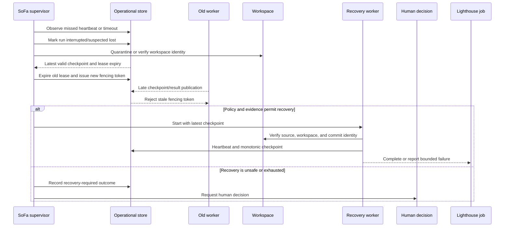

# 6. Runtime view

## Runtime scenarios

### Current Lighthouse execution boundary

This is the current observed path, not the target engine path. The self-hosted runner executes the Lighthouse job; no SoFa process, OpenCode adapter, lease, checkpoint, or SoFa operational result is present in the path. The `lighthouse.yml` repository guardrail workflow is a separate verification workflow and is not the SDLC router.

The registration used by this path is scoped to the repository that owns the workflow. In the personal-factory deployment, each participating repository has a different registration on the same Bastion. The shared physical host must not be confused with an account-wide GitHub runner.

### Target lifecycle beyond the first host adapter

The router remains responsible for choosing a route and stage. The Lighthouse worker remains responsible for stage semantics and writing the current `stage-result` artifact. GitHub Actions remains responsible for job orchestration and artifact publication. The GitHub runner executes the job assigned to its capability. The target host adapter makes the job enter SoFa admission; SoFa then creates the ephemeral workspace and supervises persistent OpenCode using the dedicated execution account's Codex/ChatGPT authentication. OpenCode performs agentic work and provider/model selection; it does not choose the lifecycle transition. A gateway may sit behind the provider boundary when configured, but it is not required for the initial subscription-authenticated path.

For a personal account, the same sequence is repeated through the repository-specific registration for each participating repository. The SoFa supervisor is the shared host-level admission point, so jobs arriving through registrations A, B, and C may run concurrently only up to the configured healthy capacity. Each admitted run gets its own worker and workspace. Implementing that bounded admission is part of the SoFa runner adapter; GitHub's runner labels do not provide it.

`ff` is a Lighthouse composition mode. Its next stage is invoked only after the previous job succeeds and its declared result is valid. A failed, blocked, unavailable, or missing prerequisite stops the chain. SoFa reports the operational outcome; it does not turn a successful job into an implicit human decision.

### Failure, lease expiry, and recovery

Recovery never treats a missing heartbeat as success. It is permitted only when the latest checkpoint, workspace identity, source revision, and policy make continuation safe. A stale worker cannot publish because every state-changing publication is checked against the current fencing token. If recovery bounds are exhausted or evidence is uncertain, the run stops for a human decision.

### Cancellation and timeout

Cancellation is an explicit operational outcome. The supervisor stops admitting new work for the run, requests engine cancellation, records the last acknowledged checkpoint, releases or expires the lease, and cleans or quarantines the workspace. A timeout follows the same path but records the configured timeout reason. Neither outcome is converted into a Lighthouse gate or delivery acceptance.

## Target admission and publication protocol

The current workflows do not enforce the complete target sequence. In particular, their structural validation can accept a blocked stage result while the router advances on job success. SoFa must require the repaired Lighthouse continuation validator before executing a composed route. Do not compensate by inventing different gates in SoFa.

The accepted target protocol in [ADR-0004](../09-architecture-decisions/0004-local-admission-and-fenced-publication.md) is:

1. A repository-bound bridge connects through its permitted Unix socket and submits a Lighthouse request. The supervisor derives repository identity from the provisioned client identity and checks it against the payload, configured workflow/revision and policy. No caller-selected host path or arbitrary command is accepted.
2. Admission inserts or finds the idempotency identity in a transaction, checks global and per-project capacity, reserves the work item, issues a fencing token and records the deadline. A repeated request returns the same attempt; a changed payload under the same key is rejected.
3. The worker obtains a run-specific workspace from a trusted checkout at the requested commit. It invokes one engine session with Lighthouse role context, permitted tools and effective limits. The GitHub job is transport; worker lifetime belongs to the supervisor.
4. Verified setup, patch/test artifacts and publication receipts form checkpoints. Persist a bounded sequence and digest before acknowledging progress. A model conversation or successful command alone is not a recoverable checkpoint.
5. The publisher loads the candidate stage result and effects, applies Lighthouse validation, checks current source/policy/approval and verifies the lease under the publication fence. It performs only allowed effects, records receipts and returns the unchanged stage result plus operational evidence.
6. Lighthouse records the resulting transition and decides continuation. Waiting for a human releases execution capacity; resumption uses a new admitted request and current evidence. It must not keep an engine running while waiting for approval.
7. On GitHub cancellation or loss of the waiting bridge, request cancellation. Independently enforce the persisted deadline and heartbeat expiry so a dead runner cannot leave an unbounded orphan. Cleanup or quarantine precedes reuse of resources.

<!-- pdac:cite id="FR-RECOVERABLE-EXECUTION" digest="sha256:d5bed96280fd88240c3492cc4ff6a609ad80e6d6b2891e536c36f36a78772678" -->

### Publication race and recovery

Fencing only database writes is insufficient. The engine must have no direct credential for a remote write. Serialize final authority checks, publication and recovery handover for the same resource; retain the effect intent before sending it. If the remote call times out after it may have succeeded, mark publication uncertain, inspect the target by stable identity and reconcile before retry. If the effect cannot be identified safely, stop for a human. Do not claim exactly-once network delivery.

The engine's local process is terminated or isolated when its lease expires. A replacement may resume from verified artifacts and receipts, but cannot blindly replay a push, merge or partially executed tool call. Human approval binds the actual revision and policy; recovery does not manufacture fresh approval.

<!-- pdac:cite id="BR-HUMAN-DECISION-BOUNDARIES" digest="sha256:e18b9a12d0dd80fe7a4f5ee7e7acc6a6329a6c07ec87cb6a59813f1eaea450f9" -->

## Implemented supervised stage path

The opt-in `lighthouse-host.yml` accepts owner-authored issue events, exact command comments or manual dispatch. The repository runner invokes the bridge without checking out or executing repository code. Admission verifies the kernel peer UID, pinned Lighthouse package/policy, current source commit and the live GitHub workflow run. Refinement also requires a published passing triage result and an owner comment bound to its digest and run identity.

PostgreSQL serializes admission and allows one active execution globally. Exact duplicate requests return their existing state. Fresh event identities are capped at three attempts per issue, stage and source revision. A supervisor holds a PostgreSQL advisory leadership lock; each run retains a fencing counter and a deadline. The engine receives a read-only source snapshot, trusted stage context and one writable result file.

Before publication the supervisor revalidates the issue, source, workflow and predecessor decision. It stores the complete intent, locks the run row, checks the fence and deadline, and records the GitHub receipt before releasing capacity. A missing response leaves publication uncertain and blocks new admission. Restart stops the old container and searches for the exact owner-authored comment; it does not repost an uncertain effect. Interrupted model work needs a fresh request. Cancellation is serialized against claim/publication, and the container is stopped before the execution slot is released.

A valid published report moves the operational run to `waiting-human`. The contained Lighthouse status still distinguishes a completed stage from a question or blocker. No operation in this slice approves a gate, pushes a branch or merges a PR. [The operator runbook](../../runbooks/supervised-pilot.md) describes deployment and evidence collection.
