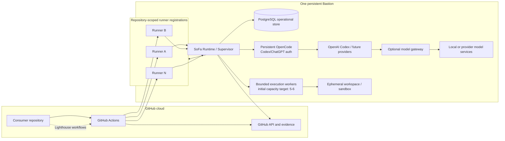

# 7. Deployment view

## Infrastructure overview



The machine is persistent; the execution and workspace are ephemeral. The initial topology does not assume autoscaling, KEDA, a host fleet, a broker, or ephemeral machines. Because the repositories are owned by a personal GitHub account, the host has one repository-scoped runner registration per participating repository. This is the GitHub-compatible way to share one physical Bastion without pretending that a personal account has an organization-level runner scope.

The repository contains no SoFa deployment or runtime implementation. Bastion evidence is narrower: the `juangcarmona/sofa` repository currently has one active runner registration, `bastion-01`, with labels `[self-hosted, Linux, X64, lighthouse-sdlc, bastion]`; its systemd service is enabled and runs as the dedicated `github-runner` account from `/opt/actions-runner/sofa`. This proves GitHub job delivery capability only. It does not prove a SoFa handoff, admission, lease, workspace lifecycle, or OpenCode supervision.

OpenCode `v2.1.0` is installed on Bastion for the `juan` account at `/home/juan/.opencode/bin/opencode`. No OpenCode authentication file was found for either the interactive account or `/var/lib/github-runner` during the metadata-only inspection. The SoFa Runtime, operational store, execution worker, service-account Codex/ChatGPT authentication, optional gateway, and model services in the diagram are therefore target deployment elements, not installed components. The current Lighthouse job still runs gh-aw/Copilot and is not the target OpenCode handoff.

## Deployment mapping

| Deployment element | Persistent or ephemeral | Initial responsibility |
| --- | --- | --- |
| Bastion operating system and service management | Persistent | Keep the SoFa deployment, runner, gateway, and local model services available and diagnosable. |
| SoFa Runtime / Supervisor | Persistent process | Coordinate scheduling, admission, leases, recovery, health, and execution lifecycle. |
| GitHub Actions self-hosted runner registration set | Persistent processes | Receive jobs for the repository to which each registration belongs and execute workflow steps labelled for the SoFa capability. Each registration has its own directory, service, token, and workspace root; a label does not establish a callback into the SoFa process or a global capacity limit. |
| Operational PostgreSQL | Persistent service/data | Store bounded operational state, recovery records, and evidence references. |
| OpenCode and its execution-account authentication | Persistent installation and credential state | Execute the scoped run and select the configured OpenAI Codex/future provider model. Credentials remain outside repositories, workspaces, GitHub secrets, and artifacts. |
| Model gateway and local/provider model services | Optional persistent services | Route and serve model requests when configured; expose health and bounded usage metadata. The initial OpenAI Codex subscription path may connect directly from OpenCode. |
| SoFa execution worker | Per execution | Perform one admitted execution under a lease and fencing token; several may run concurrently within the host capacity. |
| Workspace / sandbox | Per execution | Checkout and temporary tool state for one run; clean or quarantine after termination. |
| Execution logs and model metadata | Bounded per execution | Retain only the operational/evidence subset needed by policy; do not persist full transcripts by default. |

### Personal-repository registration procedure

For every repository that is allowed to use the Bastion:

1. Open that repository's `Settings → Actions → Runners → New self-hosted runner` page.
2. Select the Bastion operating system and architecture and use the generated, time-limited registration token.
3. Configure a distinct runner directory and service, for example `/opt/actions-runner/<repository>` and `bastion-<repository>`.
4. Add the capability labels `[self-hosted, linux, lighthouse-sdlc]` required by the Lighthouse stage workflows.
5. Run the service as the dedicated local `github-runner` user, never as the personal administrator account or root.
6. Keep the working directory and workspace root distinct for every registration.

This procedure subscribes that repository's GitHub Actions jobs to the Bastion. It does not by itself invoke SoFa, acquire a lease, create a checkpoint, or enforce global capacity. Those responsibilities belong to the SoFa adapter and supervisor.

### Capacity and resource model

A lock alone is not an isolation boundary. SoFa uses admission capacity to decide how many runs may be active and a separate per-run workspace/sandbox to prevent contamination. The effective concurrency is the lowest healthy limit among:

```text
effective capacity = min(
  configured host limit,
  online runner registrations,
  available memory / measured per-run memory budget,
  free disk / measured per-run workspace budget,
  safe model-gateway and model-service concurrency
)
```

The runner registration itself is comparatively small compared with a checkout, dependency tree, build output, agent process, and model-service pressure. The runner package shown by the current GitHub setup page is 227,660,598 bytes compressed for Linux x64 (`2.338.0`); the extracted installation and logs must be measured on Bastion. Five or six registrations therefore cost roughly the package size multiplied by the number of separate installations if binaries are duplicated, while five or six concurrent workspaces and agent processes are the dominant sizing variables.

The initial architecture target is five to six concurrent trusted-repository runs, not a guaranteed capacity number. Before enabling that level, the implementation must measure idle runner memory, per-run peak memory, workspace growth, disk cleanup, model-service concurrency, and recovery headroom. SoFa must queue or reject new work when those measurements or health signals make another run unsafe.

### Lifecycle and cleanup

At admission, SoFa creates a run, acquires a lease, allocates a workspace, and binds the run to a source revision and worker identity. At normal completion it records references, removes transient credentials and mounts, cleans the workspace, and releases the lease. At failure or cancellation it records the reason and either cleans or quarantines the workspace for bounded recovery. A quarantined workspace is never reused by an unrelated run.

The trusted-repository first slice may use a container or equivalent isolated workspace without the host Docker socket and without unnecessary privileges. Forks or code classified as untrusted require a stronger boundary such as Docker Sandbox or a microVM; that is an evolution decision, not a first-slice requirement. The isolation backend remains an implementation seam only if more than one backend is actually needed.

## Target pilot deployment

[ADR-0004](../09-architecture-decisions/0004-local-admission-and-fenced-publication.md) defines these local boundaries. They are deployment work to perform before the pilot, not observed services:

- One .NET admission/supervisor service and PostgreSQL store on Bastion, with Aspire for composition and diagnostics.
- One repository-scoped GitHub runner and provisioned local bridge identity per participating repository. The existing shared service account must not be mistaken for per-repository credential isolation; distinct service identities and socket permissions are part of the proposal.
- A local Unix socket for bridge requests. No new LAN or public execution API is needed.
- One isolated workspace/process group per admitted attempt, with only the selected engine credentials available to its execution boundary. The publisher alone holds repository mutation credentials.
- Global active capacity one during the pilot, with the product default of one execution per project. Increase towards the accepted five-to-six sizing target only after measuring real memory, disk, model limits and cleanup headroom.

<!-- pdac:cite id="BR-CAPACITY-DEFAULTS" digest="sha256:28f4ba63d81bb6a35fab5ae4d76888e749ce48a5505a131789298263761b8986" -->

Runner bootstrap, checkout and dependency installation also consume resources before engine admission. Keep bootstrap small, serialize expensive setup after admission where possible and include remaining runner overhead in host capacity measurements. Engine capacity is not the entire machine's resource budget.
