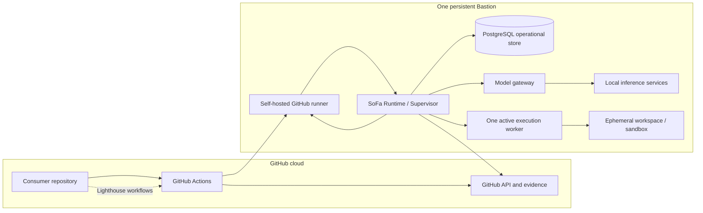

# 7. Deployment view

## Infrastructure overview

The machine is persistent; the execution and workspace are ephemeral. The initial topology does not assume autoscaling, KEDA, a host fleet, a broker, or ephemeral machines.

The current repository has no Bastion deployment, SoFa process, PostgreSQL instance, or runner configuration to inspect. The only present runtime mapping is the Lighthouse workflow contract: GitHub Actions schedules the compiled agent job onto a runner labelled `[self-hosted, linux, lighthouse-sdlc]`. That job currently runs gh-aw/Copilot. The SoFa Runtime, operational store, execution worker, workspace lifecycle, gateway, and model services in the diagram are target deployment elements, not installed components.

## Deployment mapping

| Deployment element | Persistent or ephemeral | Initial responsibility |
| --- | --- | --- |
| Bastion operating system and service management | Persistent | Keep the SoFa deployment, runner, gateway, and local model services available and diagnosable. |
| SoFa Runtime / Supervisor | Persistent process | Coordinate scheduling, admission, leases, recovery, health, and execution lifecycle. |
| GitHub Actions self-hosted runner service | Persistent process | Receive jobs labelled for the SoFa capability and execute repository workflow steps. A label does not establish a callback into the SoFa process. |
| Operational PostgreSQL | Persistent service/data | Store bounded operational state, recovery records, and evidence references. |
| Model gateway and local model services | Persistent services | Route and serve model requests; expose health and bounded usage metadata. |
| SoFa execution worker | Per execution | Perform one admitted execution under a lease and fencing token. |
| Workspace / sandbox | Per execution | Checkout and temporary tool state for one run; clean or quarantine after termination. |
| Execution logs and model metadata | Bounded per execution | Retain only the operational/evidence subset needed by policy; do not persist full transcripts by default. |

### Lifecycle and cleanup

At admission, SoFa creates a run, acquires a lease, allocates a workspace, and binds the run to a source revision and worker identity. At normal completion it records references, removes transient credentials and mounts, cleans the workspace, and releases the lease. At failure or cancellation it records the reason and either cleans or quarantines the workspace for bounded recovery. A quarantined workspace is never reused by an unrelated run.

The trusted-repository first slice may use a container or equivalent isolated workspace without the host Docker socket and without unnecessary privileges. Forks or code classified as untrusted require a stronger boundary such as Docker Sandbox or a microVM; that is an evolution decision, not a first-slice requirement. The isolation backend remains an implementation seam only if more than one backend is actually needed.
