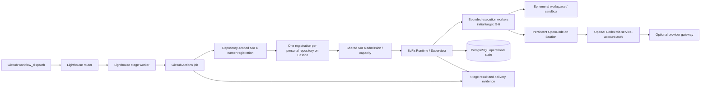

# Runtime architecture: reviewed target

**Status:** target architecture for the implementation phase, 2026-10-24. This document refines the original S0 proposal; it does not install services or authorize implementation.

The canonical architectural views are now in [`docs/architecture/`](../architecture/README.md), and the durable ownership boundary is recorded in [ADR-0001](../architecture/09-architecture-decisions/0001-lighthouse-delivery-workflow-sofa-bastion-runtime.md). This roadmap document remains the planning-level summary.

## Revision against evidence

The original proposal is retained where it matches the current product model and infrastructure constraints: one modular .NET 10 application, Aspire composition, PostgreSQL operational state, an independently supervised Worker, and OpenCode as the external execution engine. The inspected Lighthouse routes, skills, stage-result contract, and gh-aw workflows require one explicit adaptation: Lighthouse, not SoFa, owns repository stages, route composition, gates, stage results, and delivery evidence. SoFa is the runtime supervisor and operational control plane behind the GitHub Actions runner capability. The engine correction is also explicit: the target job hands off to SoFa, which invokes persistent OpenCode on Bastion; gh-aw's current Copilot engine is observed transitional configuration, not the target provider path.

The original proposal did not prove a central webhook, a host fleet, autoscaling, KEDA, a broker, or a stronger sandbox for trusted repositories. Those are not part of the first slice. A stronger sandbox remains a future requirement for untrusted forks or code.

The GitHub deployment constraint is explicit: SoFa is operated across Juan's personal repositories, not an organization. GitHub runner registrations are therefore repository-scoped. The target uses one persistent Bastion with one registration, directory, service, and working directory per participating repository. These registrations share the physical host, while SoFa owns the host-level admission and bounded concurrency rule. The initial capacity target is five to six isolated executions, subject to resource measurement and health. No account-wide GitHub runner registration is assumed, and no central webhook is introduced to hide that constraint.

## Current execution audit

The selected Lighthouse package is `@juangcarmona/lighthouse-sdlc@0.8.0` through Lighthouse `0.9.0`. Its current router is manually triggered with `workflow_dispatch`; the stage workers are composed with `workflow_call`; and the agent job is assigned to `[self-hosted, linux, lighthouse-sdlc]`. The compiled job currently runs gh-aw with the `copilot` engine, validates the Lighthouse `stage-result`, and uploads that artifact. The observed run failed during Copilot credential activation before the agent job reached Bastion. With no route decisions supplied, `supervised` and `plan-only` are runnable; `unattended`, `hotfix`, and `stacked` are valid routes but blocked by their declared prerequisites.

The machine-readable stage descriptor currently declares `gate: done` for `integrate`. The architecture treats integration as an integration result and merge preparation, not as a new lifecycle gate. SoFa must preserve the published `stage-result` contract without introducing another gate, and this interpretation needs an explicit compatibility test before implementation.

SoFa currently has no application runtime, runner component, persistence, OpenCode adapter, Bastion deployment, or model gateway implementation. The runner label is therefore only a GitHub Actions capability contract. It does not prove that a job calls a SoFa supervisor, acquires a SoFa lease, creates a SoFa checkpoint, or invokes OpenCode. The target diagrams must be read as the desired adapter boundary, not as the current execution sequence.

## Shape

Use one .NET 10 modular application composed by Aspire, with PostgreSQL for the minimum durable operational state, an independently supervised Worker for execution, and persistent OpenCode on Bastion. Keep the web surface and Worker as separate processes with narrow contracts; do not introduce microservices, a broker, or a generic orchestration framework.

The runtime modules stay independent through narrow contracts. Any existing unauthenticated LAN read route is legacy infrastructure, not a factory control boundary; it must not reach execution or privileged capabilities. GitHub Actions remains the initial dispatch transport, so no central SoFa webhook is required.

## Responsibilities

| Component | Owns | Does not own |
| --- | --- | --- |
| Web | Non-privileged read surface and a separately authenticated control entry point when accepted. | Worker authority, GitHub mutation, or secrets in the browser. |
| Backlog/Triage projection | Project/work-item identity and scheduling input references. | Lighthouse triage, route semantics, or replacing GitHub's issue authority. |
| Scheduling | Eligibility, WIP, risk policy, and cross-project selection. | Implementation or human approvals. |
| Worker and supervisor | Lease acquisition, checkpointed execution, cancellation, recovery, and sanitized telemetry. | Unbounded command execution, lifecycle policy, or gate changes. |
| Execution adapter | Run boundary and OpenCode process contract. | Secrets policy, scheduling, stage semantics, or merge authority. |
| Verification/evidence projection | References to checks, PRs, stage results, authorized integration, and post-delivery observations. | Replacing Lighthouse evidence or claiming human approval from automation. |
| PostgreSQL | Durable control-plane records and concurrency guarantees. | Prompts, credentials, full transcripts, or arbitrary source archives by default. |
| Aspire AppHost | Local composition, dependency wiring, and operational telemetry. | Product workflow or durable business state. |

## Minimum durable state

The first recoverable slice needs only the following relational state. Names are conceptual and must not be treated as an accepted schema.

| Record | Minimum fields | Purpose |
| --- | --- | --- |
| `work_item` | stable ID, GitHub repository/issue identity, title/summary, priority, risk, lifecycle state, source revision, created/updated timestamps | Reconcile a local coordination projection with GitHub and avoid losing triage context. |
| `dependency` | work item IDs, dependency kind, source/evidence reference, state | Prevent scheduling work whose prerequisite is not complete. |
| `execution_run` | run ID, work item ID, stage, attempt, requested policy, status, worker identity, started/finished timestamps, outcome | Make every run addressable and recoverable. |
| `lease` | resource key, owner, expiration, fencing token, acquired/released timestamps | Ensure one active executor per work unit and protect against a stale Worker. |
| `checkpoint` | run ID, monotonic sequence, stage, idempotency key, workspace/commit reference, safe state payload, timestamp | Resume from a known boundary or stop with an explicit recovery reason. |
| `evidence` | run ID/work item ID, kind, source URI/ID, commit/PR/CI/deployment identifiers, observed timestamp, result, digest where available | Tie verification and delivery claims to source evidence. |
| `worker_heartbeat` | worker ID, process version, last-seen, capability/policy summary, health state | Detect stale supervision without treating liveness as successful delivery. |

Use unique keys for GitHub repository/issue identity, active leases, checkpoint sequence, and evidence source identity. Use database transactions for lease acquisition and checkpoint publication; use fencing tokens so a late Worker cannot publish after lease expiry. Retain a small append-only state-transition history or equivalent audit record for recovery and human review.

Do not persist credentials, authorization headers, raw prompts, source code, or full OpenCode transcripts by default. Store references, summaries, hashes, and bounded tool/result metadata only when needed for evidence and recovery. Retention and deletion policy are open product/operational decisions.

## Execution and recovery loop

1. Scheduling selects a ready work unit and records the accepted risk/autonomy profile.
2. The Worker atomically acquires a lease and creates an execution run.
3. The OpenCode adapter receives only the scoped workspace, task contract, and allowed capabilities.
4. The Worker records checkpoints at stage boundaries: setup, implementation, verification, PR/evidence, and terminal outcome.
5. A cancellation, process loss, timeout, or lease conflict produces an explicit interrupted/blocked result. It never reports success from a missing heartbeat.
6. Recovery finds the latest valid checkpoint, verifies the workspace/commit identity, reacquires a fresh lease, and resumes only when the policy permits. Otherwise it stops for Juan.
7. Verification records deterministic checks and judgement gates separately. Integration and delivery remain explicit authorized transitions.

## Security proposal

The current unauthenticated LAN exposure is a trusted-network convenience, not authentication. Preserve it as a non-privileged route: no GitHub write token, process launch, shell endpoint, control-plane mutation, or Worker dispatch may be reachable through it.

The execution/control boundary should initially be loopback-only and separately authenticated, with CSRF/origin protection for browser requests, strict allowlists for command capabilities, secret injection outside the browser, and an explicit denial for privileged operations. If LAN control is later required, add an accepted authentication and authorization decision before binding it to a LAN address. Aspire dashboard access remains separately protected and is not the product control plane.

## Operational health and telemetry

Use standard .NET/Aspire OpenTelemetry for correlated traces, metrics, and logs. Keep telemetry about execution diagnosis, not as the durable source of product state. Bound dimensions to project, work item class, stage, outcome, and worker; exclude secrets, prompts, source text, and high-cardinality PR titles.

Minimum health signals are Worker heartbeat age, lease age/expiry, checkpoint lag, queue/eligible-work count, PostgreSQL connectivity, OpenCode process outcome, verification failure count, and recovery-required count. Maintenance must include stale-lease reconciliation, failed-run retention, evidence cleanup according to policy, database backups/restore checks, and version drift checks. Each maintenance action needs an owner and must remain observable.

## Decisions still open for implementation

- .NET 10 SDK and compatible Aspire package versions on Bastion.
- PostgreSQL placement, backup/restore, and credential management.
- OpenCode process contract, workspace isolation, allowed tools, and cancellation semantics.
- Authentication for the control boundary and the exact risk-policy schema.
- The versioned wire schema and authentication for the Lighthouse-to-SoFa handoff.
- The trusted-repository classification mechanism and the isolation driver.
- Retention and deletion implementation for operational records and evidence.
- The exact mechanism by which a Lighthouse job hands an execution contract to SoFa; the runner label alone is insufficient.
- The non-interactive health check proving that the dedicated `github-runner` account can use the OpenCode Codex/ChatGPT authentication.
- The capability-to-model profile and whether future providers use the optional gateway or direct OpenCode provider configuration.
- The adapter mechanism that makes every repository-scoped registration enter the shared SoFa admission boundary before agent execution; the current gh-aw worker runs directly on the runner and does not yet provide this handoff.
- The exact Bastion concurrency limit after measuring model services, agent processes, workspaces, disk, memory, and thermal/network headroom; five to six is the initial sizing target, not a measured limit.
- Whether supervision is at GitHub job level, engine-process level, or both, and which boundary owns checkpoint emission.

Production deployment is outside the first slice and is not a Lighthouse stage. Any future delivery/deployment capability requires a separate product and architecture decision; it must not be introduced as an implicit lifecycle transition.
