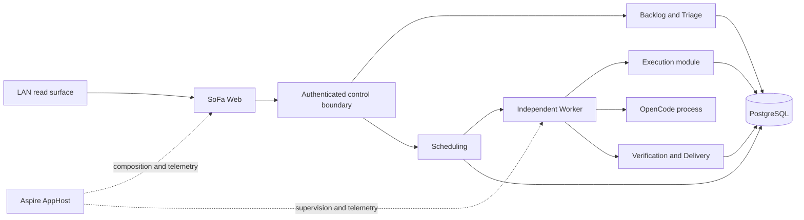

# Initial runtime architecture proposal

**Status:** proposed, not accepted. This document is a planning artifact for S0. It does not amend ADR-0001, install services, or authorize execution.

## Shape

Use one .NET 10 modular application composed by Aspire, with PostgreSQL for the minimum durable control-plane state, an independently supervised Worker for execution, and OpenCode as an external execution engine. Keep the web surface and Worker as separate processes with narrow contracts; do not introduce microservices, a broker, or a generic orchestration framework.

The factory modules stay independent of one another through narrow contracts. Any existing unauthenticated LAN read route is legacy infrastructure, not a factory control boundary; it must not reach execution or privileged capabilities.

## Responsibilities

| Component | Owns | Does not own |
| --- | --- | --- |
| Web | Non-privileged read surface and a separately authenticated control entry point when accepted. | Worker authority, GitHub mutation, or secrets in the browser. |
| Backlog/Triage | GitHub projection, priorities, dependency edges, and ready work-unit shape. | Replacing GitHub's issue authority. |
| Scheduling | Eligibility, WIP, risk policy, and cross-project selection. | Implementation or human approvals. |
| Worker | Lease acquisition, checkpointed execution, cancellation, recovery, and sanitized telemetry. | Unbounded command execution or policy changes. |
| Execution | Run state machine and OpenCode adapter contract. | Secrets policy, scheduling, or merge authority. |
| Verification/Delivery | Checks, PR/evidence links, authorized integration, and post-delivery verification. | Claiming human approval from automation. |
| PostgreSQL | Durable control-plane records and concurrency guarantees. | Prompts, credentials, full transcripts, or arbitrary source archives by default. |
| Aspire AppHost | Local composition, dependency wiring, and operational telemetry. | Product workflow or durable business state. |

## Minimum durable state

The first recoverable slice needs only the following relational state. Names are conceptual and must not be treated as an accepted schema.

| Record | Minimum fields | Purpose |
| --- | --- | --- |
| `work_item` | stable ID, GitHub repository/issue identity, title/summary, priority, risk, lifecycle state, source revision, created/updated timestamps | Reconcile a local coordination projection with GitHub and avoid losing triage context. |
| `dependency` | work item IDs, dependency kind, source/evidence reference, state | Prevent scheduling work whose prerequisite is not complete. |
| `execution_run` | run ID, work item ID, stage, attempt, requested policy, status, worker identity, started/finished timestamps, outcome | Make every run addressable and recoverable. |
| `lease` | resource key, owner, expiration, fencing token, acquired/released timestamps | Ensure one active executor per work unit and protect against a stale Worker. |
| `checkpoint` | run ID, monotonic sequence, stage, idempotency key, workspace/commit reference, safe state payload, timestamp | Resume from a known boundary or stop with an explicit recovery reason. |
| `evidence` | run ID/work item ID, kind, source URI/ID, commit/PR/CI/deployment identifiers, observed timestamp, result, digest where available | Tie verification and delivery claims to source evidence. |
| `worker_heartbeat` | worker ID, process version, last-seen, capability/policy summary, health state | Detect stale supervision without treating liveness as successful delivery. |

Use unique keys for GitHub repository/issue identity, active leases, checkpoint sequence, and evidence source identity. Use database transactions for lease acquisition and checkpoint publication; use fencing tokens so a late Worker cannot publish after lease expiry. Retain a small append-only state-transition history or equivalent audit record for recovery and human review.

Do not persist credentials, authorization headers, raw prompts, source code, or full OpenCode transcripts by default. Store references, summaries, hashes, and bounded tool/result metadata only when needed for evidence and recovery. Retention and deletion policy are open product/operational decisions.

## Execution and recovery loop

1. Scheduling selects a ready work unit and records the accepted risk/autonomy profile.
2. The Worker atomically acquires a lease and creates an execution run.
3. The OpenCode adapter receives only the scoped workspace, task contract, and allowed capabilities.
4. The Worker records checkpoints at stage boundaries: setup, implementation, verification, PR/evidence, and terminal outcome.
5. A cancellation, process loss, timeout, or lease conflict produces an explicit interrupted/blocked result. It never reports success from a missing heartbeat.
6. Recovery finds the latest valid checkpoint, verifies the workspace/commit identity, reacquires a fresh lease, and resumes only when the policy permits. Otherwise it stops for Juan.
7. Verification records deterministic checks and judgement gates separately. Integration and delivery remain explicit authorized transitions.

## Security proposal

The current unauthenticated LAN exposure is a trusted-network convenience, not authentication. Preserve it as a non-privileged route: no GitHub write token, process launch, shell endpoint, control-plane mutation, or Worker dispatch may be reachable through it.

The execution/control boundary should initially be loopback-only and separately authenticated, with CSRF/origin protection for browser requests, strict allowlists for command capabilities, secret injection outside the browser, and an explicit denial for privileged operations. If LAN control is later required, add an accepted authentication and authorization decision before binding it to a LAN address. Aspire dashboard access remains separately protected and is not the product control plane.

## Operational health and telemetry

Use standard .NET/Aspire OpenTelemetry for correlated traces, metrics, and logs. Keep telemetry about execution diagnosis, not as the durable source of product state. Bound dimensions to project, work item class, stage, outcome, and worker; exclude secrets, prompts, source text, and high-cardinality PR titles.

Minimum health signals are Worker heartbeat age, lease age/expiry, checkpoint lag, queue/eligible-work count, PostgreSQL connectivity, OpenCode process outcome, verification failure count, and recovery-required count. Maintenance must include stale-lease reconciliation, failed-run retention, evidence cleanup according to policy, database backups/restore checks, and version drift checks. Each maintenance action needs an owner and must remain observable.

## Open architecture decisions

- .NET 10 SDK and compatible Aspire package versions on Bastion.
- PostgreSQL placement, backup/restore, and credential management.
- OpenCode process contract, workspace isolation, allowed tools, and cancellation semantics.
- Authentication for the control boundary and the exact risk-policy schema.
- Whether delivery includes production deployment or only post-merge verification in the first slice.
