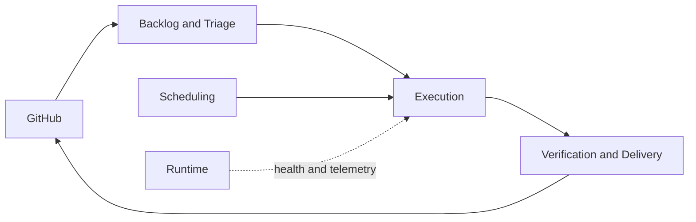

# SoFa Software Factory roadmap

**Planning status:** S0 architecture alignment complete, 2026-10-24. This document records planning and reconciliation work only. It does not authorize execution or change the runtime.

## Evidence boundary

| Classification | Current evidence |
| --- | --- |
| Accepted product intent | `docs/product/model/` contains the applied Software Factory baseline from `CHG-INITIAL`. The former Repository Attention proposal remains separate historical material and is explicitly excluded from the product. |
| Draft product intent | No active Product Change is present. The completed change record still contains one stale sentence saying there is no accepted definition; it is provider-owned history and must be corrected through ProductShape, not by hand. |
| Target architecture | The twelve ArcShape sections and [ADR-0001](../architecture/09-architecture-decisions/0001-lighthouse-delivery-workflow-sofa-bastion-runtime.md) define the reviewed Lighthouse/SoFa/Bastion boundary. The target remains unimplemented. |
| Implementation reality | This repository has no application runtime, runner, persistence, or execution workflow. The target documentation is not implementation evidence. |
| S0 assumptions | PostgreSQL, an independently supervised Worker, OpenCode, and the execution/delivery contexts below are proposed targets. They require product and architecture acceptance before installation or implementation. |

## S0 outcome

SoFa is a personal Software Factory that helps Juan select and deliver small, recoverable work across any configured project. GitHub remains the backlog and source-of-truth system. SoFa coordinates evidence, leases, checkpoints, verification, and policy-bound decisions; it does not become a second issue tracker or silently acquire authority.

S0 prepares the first executable slice by:

1. recording the applied product baseline in [CHG-INITIAL](../product/changes/completed/chg-initial/change.md) without adding implementation authority;
2. explicitly excluding the historical Repository Attention proposal from the product scope;
3. reconciling the existing checkout against Lighthouse ownership and published versions;
4. documenting and recording the reviewed .NET 10, Aspire, PostgreSQL, Worker, OpenCode, Lighthouse, and Bastion architecture; and
5. defining a small, dependency-aware backlog and a future acceptance pilot.

The roadmap does not install PostgreSQL or OpenCode, update provider-owned integrations, create execution workflows, or expose execution through the current unauthenticated LAN surface.

## Proposed product change

The proposed future product has one personal actor, GitHub as the external backlog/evidence authority, and these bounded contexts:

| Context | Responsibility | Explicit boundary |
| --- | --- | --- |
| Backlog and Triage | Import and classify GitHub issues, retain project/issue priority, and shape small work units with dependencies. | GitHub remains the source of truth; SoFa stores a local coordination projection and never invents a competing issue state. |
| Execution | Run one authorized work unit through a leased, checkpointed engineering loop. | Does not own scheduling, delivery authority, or product approval. |
| Scheduling | Continuously select eligible work across projects subject to dependencies, WIP, risk, leases, capacity, and policy. | It may recommend or dispatch only while authority is active and within an accepted autonomy policy; pause and revocation must be supported. |
| Verification and Delivery | Collect deterministic checks, review evidence, PR state, authorized integration, and verified delivery evidence. | It cannot turn a green check into human approval or deploy without an explicit product and operational gate. |
| Runtime Operations | Observe health, worker liveness, telemetry, maintenance, and recovery posture. | Operational telemetry is not product evidence and does not grant execution authority. |

The factory keeps Backlog/Triage, Execution, Scheduling, Verification/Delivery, and Runtime Operations independent through explicit ports. No context silently acquires another context's authority.

## Product evolution

The proposed change covers:

- GitHub-backed backlog ingestion and triage, with project and issue priorities preserved and visible;
- small work units with explicit dependencies, scope, acceptance criteria, risk, and a named decision boundary;
- durable execution runs with leases, checkpoints, idempotency, recovery, and evidence references;
- human decision boundaries for product intent, architecture, risky operations, PR approval, integration, and delivery;
- risk-based autonomy profiles that can stop, ask, or proceed only within an accepted policy;
- evidence-driven verification from local checks through CI, PR, authorized integration, and verified delivery;
- multi-project scheduling with dependency and concurrency awareness; and
- runtime health, telemetry, maintenance, retention, and safe recovery.

This is a personal factory, not a multi-tenant service. No team identity model, commercial offering, generic plugin SDK, broker, or microservice topology is implied.

## Accepted planning defaults

These defaults are accepted for planning, but remain unimplemented until the Product Change and architecture are approved through their lifecycle:

- Critical security, privilege, destructive-data, ambiguous, or conflicting-risk work stops at a human gate.
- Retain execution metadata/checkpoints for 90 days, delivery evidence/decision records for 365 days, and detailed telemetry for 30 days by default.
- Recover automatically for at most three attempts or 30 minutes of cumulative recovery time, then stop for a human decision.
- Allow one active execution per project by default; project overrides are disabled initially and cannot exceed healthy worker capacity.
- Keep privileged control loopback-only and separately authenticated; the existing LAN surface remains read-only and non-privileged.

## Roadmap phases

| Phase | Intent | Exit evidence | Product/architecture gate |
| --- | --- | --- | --- |
| S0 — reconcile and prepare | Product baseline, bounded-context map, Lighthouse report, reviewed runtime architecture, ADR, and pilot backlog. | Ownership, trigger, persistence, isolation, recovery, and gate boundaries are documented; current verification is recorded. | Human review of the implementation plan before runtime work. |
| S1 — establish authorities | Reconcile Lighthouse, ProductShape, ArcShape, and shared lifecycle ownership in a clean worktree. | `lighthouse verify`, ProductShape integrity/doctor, ArcShape validation, and CI-like checks are green. | Accept the implementation architecture and security boundary before execution capability. |
| S2 — triage vertical slice | Read GitHub issues into a coordination projection, prioritize, split one issue, and record dependencies. | One issue reaches a ready work unit without GitHub mutation beyond explicitly authorized lifecycle operations. | Human confirms triage and risk policy. |
| S3 — recoverable execution | Execute one low-risk work unit through a supervised Worker and OpenCode with leases/checkpoints. | Interrupted execution resumes or stops safely, with no duplicate active lease and durable evidence. | Explicit acceptance of execution policy and security boundary. |
| S4 — verification and delivery | Gather checks, PR, evidence, authorized integration, and post-delivery verification. | The pilot scenario passes end to end and delivery claims match source evidence. | Human authorizes PR approval, integration, and delivery where required. |
| S5 — schedule and operate | Add continuous multi-project selection, health/maintenance loops, and bounded autonomy based on pilot evidence. | Scheduling and maintenance remain observable, recoverable, pausable, revocable, and within the accepted WIP/risk policy. | Reassess product scope before expanding autonomy. |

S0 deliberately stops before runtime implementation. The first durable slice is the smallest path that exercises the whole loop; it is not a general orchestration platform.

## Human decision boundaries and autonomy

| Decision | Default owner | Automation posture |
| --- | --- | --- |
| Product intent and Product Change approval/application | Policy-defined review and human gate for critical impact | Deterministic and semantic review may proceed automatically when policy permits; security, privilege, and destructive-data impact always stop. |
| Architecture and security boundary | Policy-defined review and human gate for critical impact | Code ownership and semantic review may proceed automatically; security and privilege impact always stop. |
| Work-item triage and priority | Juan, informed by GitHub evidence | Suggest; do not silently reorder or rewrite GitHub. |
| Low-risk local implementation and deterministic checks | Accepted execution policy | May proceed under a lease and checkpoint policy. |
| Secrets, privileged commands, network exposure, or destructive operations | Human gate | Always stop for human authorization. |
| PR approval, merge, release, and production acceptance | Configured policy, with a human gate for critical impact | Never infer authorization from green automation. |

Any existing unauthenticated LAN read surface is legacy infrastructure, not the factory control plane. It must remain non-privileged and strictly read-only while privileged commands are bound to a separately authenticated control channel.

## Dependencies on Lighthouse

SoFa should consume Lighthouse for the cross-project engineering baseline, package contracts, managed projections, and lifecycle contract. SoFa owns factory orchestration, scheduling, runners, PostgreSQL state, OpenCode supervision, repository-specific adapters, and runtime operations. ProductShape owns product intent; ArcShape owns architecture documentation; Lighthouse must not replace either authority.

The exact adoption conflicts and a non-destructive sequence are recorded in [the Lighthouse reconciliation report](lighthouse-adoption.md). The Lighthouse baseline and ArcShape structure are now adopted locally, with SoFa's authored architecture content retained. S1 still depends on recording the authority relationship, reviewing the generated workflow, and obtaining human acceptance of the broader factory change.

## Future first acceptance scenario

The first pilot is deliberately a future acceptance test because no execution runtime is installed. The implementation may use the reviewed architecture in [docs/architecture](../architecture/README.md) and [ADR-0001](../architecture/09-architecture-decisions/0001-lighthouse-delivery-workflow-sofa-bastion-runtime.md). Select one small GitHub issue from any configured project, triage it, shape one work unit, resolve dependencies, acquire a lease, execute through OpenCode, interrupt and recover once, run verification, open a PR, collect evidence, obtain any required authorized integration decision, integrate, and verify the delivered artifact. The detailed contract is in [first-pilot.md](first-pilot.md); it must not be run before implementation gates pass.
